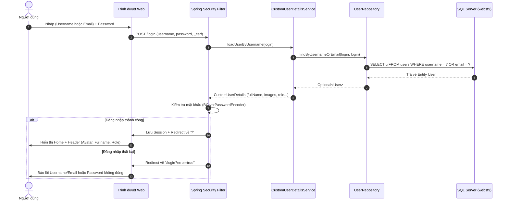

# 🔐 BT09 - VÍ DỤ 2: CUSTOM LOGIN (USERNAME HOẶC EMAIL) VỚI SPRING BOOT 4 + SPRING SECURITY 7 + THYMELEAF DIALECT

[](https://spring.io/projects/spring-boot)
[](https://spring.io/projects/spring-security)
[](https://openjdk.org/)
[](https://www.microsoft.com/sql-server)
[](https://www.thymeleaf.org/)
[](https://mapstruct.org/)
[](LICENSE)

Dự án triển khai bài tập **Ví dụ 2** theo tài liệu hướng dẫn:
> **Bài tập:** Cho bảng `User`, `Role` hãy viết chức năng **Custom Login** có thể đăng nhập bằng **Username hoặc Email** đều được, thông tin **Fullname** và **Images** của user sẽ hiển thị ở `header.html`. Sử dụng **Spring Boot 4**, **Spring Security 7**, **MapStruct**, **Thymeleaf với Dialect**.

---

## 🎯 Điểm nổi bật của dự án

1. **Custom Login linh hoạt (Username hoặc Email)**:
   - Form đăng nhập chỉ sử dụng một ô input duy nhất: người dùng có thể nhập `username` (ví dụ `user01`, `anhkhoi`) hoặc `email` (ví dụ `user01@gmail.com`, `lehuynhanhkhoi2006@gmail.com`).
   - Repository xử lý truy vấn thông minh: `findByUsernameOrEmail(login, login)`.
2. **Đối tượng tùy biến `CustomUserDetails`**:
   - Lưu trữ đầy đủ thuộc tính mở rộng: `id`, `username`, `email`, `fullName`, `images`, `role`, `enabled`.
   - Giúp View Thymeleaf dễ dàng truy xuất thông tin người dùng qua `#authentication.principal`.
3. **Thanh Header hiển thị đầy đủ thông tin**:
   - Ảnh đại diện người dùng (**Avatar** từ `images` hoặc ảnh mặc định).
   - Họ và tên đầy đủ (**Fullname**).
   - Tên đăng nhập (**Username**).
   - Hộp thư điện tử (**Email**).
   - Vai trò quyền hạn (**Role**).
   - Nút **Đăng xuất (Logout)** bảo mật.
4. **Layout kế thừa qua Thymeleaf Layout Dialect**:
   - Sử dụng thuộc tính `xmlns:layout="http://www.ultraq.net.nz/thymeleaf/layout"` và `layout:decorate="~{layouts/layout}"`.
5. **Tự động mở trình duyệt**:
   - Tích hợp `@EventListener(ApplicationReadyEvent.class)` tự động mở trình duyệt web đến `http://localhost:8081/login` ngay khi ứng dụng khởi động thành công.

---

## 🏗️ Luồng xử lý Custom Login (Authentication Flow)



---

## 🚀 Công nghệ sử dụng

| Phân hệ | Công nghệ & Thư viện | Phiên bản |
| :--- | :--- | :--- |
| **Framework** | Spring Boot | 4.1.1 |
| **Security** | Spring Security | 7.1.x (DaoAuthenticationProvider, BCrypt) |
| **Java Platform** | OpenJDK | 21+ |
| **Database** | Microsoft SQL Server | 2019 / 2022 (Database: `webst9`) |
| **ORM** | Spring Data JPA / Hibernate | 7.4.5 |
| **View Engine** | Thymeleaf + Layout Dialect | 3.1.5 + Dialect 3.x |
| **Object Mapper** | MapStruct | 1.6.3 |
| **Công cụ build** | Maven | 3.9+ |
| **Tiện ích** | Lombok, DevTools | Mới nhất |

---

## 📂 Cấu trúc thư mục dự án

```
Vi_DU_2/
├── .env                                       # Cấu hình biến môi trường (Database, Server Port)
├── .env.example                               # Mẫu file môi trường
├── .gitignore                                 # Bỏ qua file nhạy cảm và thư mục target/
├── pom.xml                                    # Khai báo dependency & Thymeleaf Layout Dialect
├── README.md                                  # Tài liệu hướng dẫn dự án
└── src/
    └── main/
        ├── java/vn/iotstar/
        │   ├── Springboot19Application.java   # Main class, seed dữ liệu & tự mở trình duyệt
        │   ├── config/
        │   │   └── SecurityConfig.java        # Cấu hình Security (Form Login, DaoAuthProvider)
        │   ├── controller/
        │   │   ├── AuthController.java        # Điều hướng /login
        │   │   └── HomeController.java        # Điều hướng / (Trang chủ)
        │   ├── dto/
        │   │   ├── LoginDTO.java              # DTO tiếp nhận thông tin login
        │   │   └── UserDTO.java               # DTO người dùng
        │   ├── entity/
        │   │   ├── Role.java                  # Entity bảng roles
        │   │   └── User.java                  # Entity bảng users (unique username, email)
        │   ├── mapper/
        │   │   └── UserMapper.java            # MapStruct User <-> UserDTO
        │   ├── repository/
        │   │   ├── RoleRepository.java        # Repository cho Role
        │   │   └── UserRepository.java        # Repository với findByUsernameOrEmail
        │   ├── security/
        │   │   ├── CustomUserDetails.java     # UserDetails chứa fullName, images, role
        │   │   └── CustomUserDetailsService.java # Nạp User theo username HOẶC email
        │   └── service/
        │       ├── UserService.java           # Interface Service User
        │       └── impl/
        │           └── UserServiceImpl.java   # Triển khai Service User
        └── resources/
            ├── application.properties         # Cấu hình Spring Boot và nạp .env
            ├── static/
            │   ├── css/
            │   │   └── app.css                # Giao diện hiện đại, responsive
            │   └── images/
            │       ├── user.png               # Ảnh avatar mẫu người dùng
            │       └── avatar-default.png     # Ảnh avatar mặc định dự phòng
            └── templates/
                ├── auth/
                │   └── login.html             # View Đăng nhập (hỗ trợ Username/Email)
                ├── fragments/
                │   └── header.html            # Header hiển thị Avatar, Fullname, Role, Logout
                ├── layouts/
                │   └── layout.html            # Layout chung dùng Thymeleaf Dialect
                └── home.html                  # View Trang chủ kế thừa layout
```

---

## 🛠️ Hướng dẫn cài đặt & Khởi chạy

### 1. Chuẩn bị Cơ sở dữ liệu (SQL Server)
Đảm bảo đã tạo database `webst9`:
```sql
CREATE DATABASE webst9;
GO
```

### 2. Cấu hình file `.env`
Tạo file `.env` tại thư mục gốc ngang cấp `pom.xml`:
```properties
# ===============================
# DATABASE
# ===============================
DB_URL=jdbc:sqlserver://localhost:1433;databaseName=webst9;encrypt=false;trustServerCertificate=true;sslProtocol=TLSv1.2;characterEncoding=UTF-8
DB_USERNAME=sa
DB_PASSWORD=13234

# ===============================
# SERVER PORT
# ===============================
SERVER_PORT=8081
```

### 3. Khởi chạy dự án

#### Chạy bằng IntelliJ IDEA
1. Mở thư mục dự án bằng **IntelliJ IDEA**.
2. Tìm đến file `vn.iotstar.Springboot19Application.java`.
3. Bấm **Run** (hoặc `Shift + F10`).
4. **Tự động mở trình duyệt**: Ứng dụng sẽ tự động bật trình duyệt web tại `http://localhost:8081/login`.

#### Chạy bằng dòng lệnh
```bash
mvn clean spring-boot:run
```

---

## 🔑 Tài khoản kiểm thử mặc định (Seed Data)

Khi khởi chạy lần đầu, ứng dụng tự động khởi tạo 2 tài khoản mẫu để bạn kiểm tra tính năng đăng nhập linh hoạt bằng **Username** hoặc **Email**:

| Tài khoản | Đăng nhập bằng Username | Đăng nhập bằng Email | Mật khẩu | Họ và tên | Vai trò |
| :--- | :--- | :--- | :--- | :--- | :--- |
| **User Mẫu** | `user01` | `user01@gmail.com` | `123456` | Nguyễn Hữu Trung | `ROLE_USER` |
| **Quản trị viên** | `anhkhoi` | `lehuynhanhkhoi2006@gmail.com` | `123456` | Lê Huỳnh Anh Khôi | `ROLE_ADMIN` |

👉 **Kiểm tra thử nghiệm**:
1. Thử đăng nhập bằng `user01` + mật khẩu `123456` -> Đăng nhập thành công, thanh header hiển thị ảnh đại diện và họ tên `Nguyễn Hữu Trung`.
2. Đăng xuất, sau đó thử đăng nhập bằng email `lehuynhanhkhoi2006@gmail.com` + mật khẩu `123456` -> Đăng nhập thành công, thanh header hiển thị ảnh đại diện và họ tên `Lê Huỳnh Anh Khôi`.

---

## 👨‍💻 Tác giả
- **Họ và tên**: Lê Huỳnh Anh Khôi
- **Email**: [lehuynhanhkhoi2006@gmail.com](mailto:lehuynhanhkhoi2006@gmail.com)
- **GitHub**: [@AnthKhoi](https://github.com/AnthKhoi)
